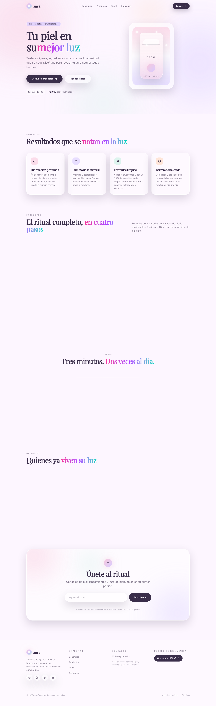

# 🪞 Aura — Landing Page

> **Tu piel en su mejor luz.** — Landing page de marca para *Aura*, skincare de lujo con estética **glassmorfismo**.

Landing page estática construida con **Astro 7 + Tailwind CSS v4 + TypeScript**, preparada para **Cloudflare Pages**. Serie de 9 landing pages por estilo de diseño (este proyecto: **Glassmorphism**).




---

## 🚀 Demo en producción

| Recurso | URL |
|---|---|
| Producción (Cloudflare Pages) | `https://aura.stevemoya.me` *(cuando conectes el repo)* |
| Preview Pages | `https://landing-aura.pages.dev` |

---

## 🧱 Stack

- **Astro 7** — SSG puro (`output: static`), sin adaptador (Cloudflare Pages sirve `dist/`)
- **Tailwind CSS v4** — tokens de marca en `src/styles/global.css` (`@theme`)
- **TypeScript 5** estricto
- **@astrojs/sitemap** + Fontsource (Playfair Display, Inter Variable) auto-hospedadas
- **Interactividad:** vanilla JS (menú móvil, header scrolled, newsletter) — CSP estricta sin `unsafe-eval` ni inline

## 📁 Arquitectura

```
src/
├── components/
│   ├── ui/          → Button, Card (glass/glass-strong), Badge, Icon, Section, Container
│   ├── layout/      → Header, Navigation, MobileMenu (vanilla JS), Footer
│   ├── sections/    → Hero (frasco glass), Benefits, Products, Ritual, Testimonials, NewsletterCTA
│   └── brand/       → Logo (gota de luz)
├── data/            → contenido tipado: site, benefits, products, ritual, testimonials
├── layouts/BaseLayout.astro  → SEO + OG + JSON-LD
├── pages/           → index.astro, 404.astro
├── scripts/         → header (vanilla), reveal (IO), newsletter (validación + feedback)
└── styles/global.css → Design System: tokens glass + reveal + reduced-motion
public/              → _headers (CSP), favicon.svg, robots.txt, og.png
```

## 🎨 Design System (Glassmorphism)

| Token | Valor | Uso |
|---|---|---|
| `ink` | `#3A2E4A` | púrpura profundo (texto) |
| `rose` / `lilac` / `peach` / `mint` | pasteles luz | luces de fondo, acentos |
| `aura-glow` | `#FDF6FF` | fondo blanco cálido |
| glass | `rgba(255,255,255,0.38)` + blur 18px | tarjetas y superficies |

- **Tipografía:** Playfair Display (serif de lujo, display) + Inter Variable (body)
- **Lenguaje visual:** luz difusa (blobs con blur animado), tarjetas de vidrio esmerilado con borde translúcido, sombras suaves, producto hero como frasco de cristal con brillos
- **Interacciones:** hover lift en cards, gift flotante, menú móvil full-screen con blur, reveal on scroll (IO)
- **Newsletter:** validación de email + feedback inline (mock sin backend)

## 🛠️ Scripts

```bash
pnpm install
pnpm dev            # desarrollo → http://localhost:4321
pnpm build          # build → dist/
pnpm preview        # preview local
pnpm check          # astro check (tipos)
```

## 🔐 Variables de entorno

Ninguna requerida. Sitio 100 % estático.

## ☁️ Deploy en Cloudflare Pages

1. [dash.cloudflare.com](https://dash.cloudflare.com) → **Workers & Pages → Create → Pages → Connect to Git** → repo `landing-aura`.
2. Build: **Build command** `pnpm build` · **Output directory** `dist` · Node 22+.
3. Deploy → Custom domains → `aura.stevemoya.me`.

> ⚠️ Crearlo como **Pages**, no como Worker (el flujo Worker ejecuta `astro add cloudflare` y falla).

## 🛡️ Seguridad

- `_headers`: CSP estricta (`default-src 'self'`), HSTS, nosniff, frame DENY
- `vite.build.assetsInlineLimit: 0` → scripts siempre externos (la CSP bloquearía los inline pequeños, dejando el contenido invisible)
- Sin secretos; `.env`/`.dev.vars` ignorados
- `security.checkOrigin: true`

## 📝 Decisiones de implementación

- **100 % CSS-first** para el glassmorfismo (blur + transparencia + luces) — sin Three.js
- **Vanilla JS** para interacciones → CSP estricta sin `unsafe-eval` ni `unsafe-inline`
- **Datos mock** (beneficios, productos, ritual, testimonios) — marca ficticia
- Newsletter mock con validación y feedback accesible (`aria-live`)

## 🧪 QA

```bash
pnpm check
pnpm build
```

Verificado: build limpio, contraste AA, sin overflow (desktop/móvil), menú móvil, navbar scrolled y newsletter funcionales, reveal bajo CSP estricta.

---

© 2026 Aura — Proyecto de portafolio de Steve Moya.